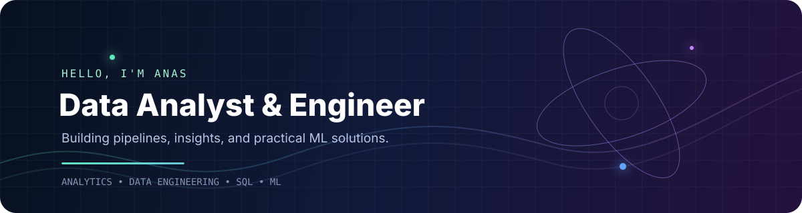
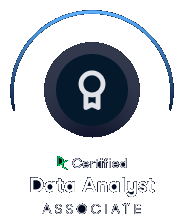
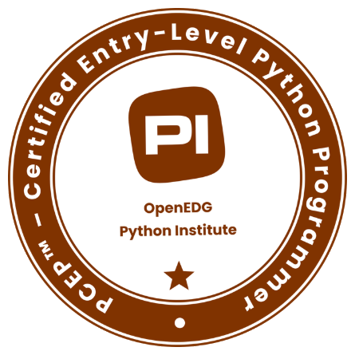

  

# Anas S. Muhammed

**Data Analyst & Data Engineer | Python · SQL · BI · ETL**

I turn complex data into clear insights and reliable workflows. My work spans analytics, data engineering, and applied machine learning, with a focus on practical, reproducible solutions.

## Featured Projects

| Project | Focus | Demonstrates |
| --- | --- | --- |
| [Smart Traffic Analytics](https://github.com/Anas-S-Muhammed/Smart_Traffic_Analytics_and_Congestion_Prediction_Platform) | Analytics + ML | Traffic analysis and congestion prediction |
| [End-to-End ETL Pipeline](https://github.com/Anas-S-Muhammed/End_to_End_ETL_pipeline) | Data engineering | Structured extraction, transformation, and loading |
| [E-Commerce Sales Analytics](https://github.com/Anas-S-Muhammed/E-Commerce_Data_Cleaning_-_Sales_Analytics) | Business analytics | Data cleaning, sales analysis, and business insights |
| [Movie Recommender](https://github.com/Anas-S-Muhammed/movie-recommender) | Applied ML | Recommendation systems and applied modeling |

## Core Tools

### Analytics & BI

### Data Engineering

### Applied Machine Learning

**Currently exploring:** Snowflake · Apache Airflow

## Certifications & Badges

  
  &nbsp;&nbsp;
  

## Connect

For collaboration or professional inquiries, connect with me on [GitHub](https://github.com/Anas-S-Muhammed).

  

  

  

